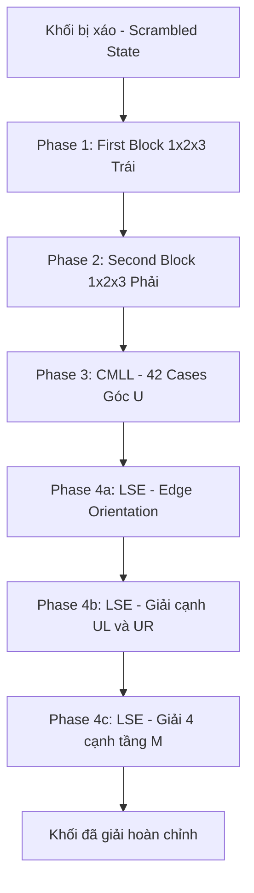

# Roux Method VN — Interactive 3D Rubik Guide

> **Ngữ cảnh dài hạn** — File này là nguồn sự thật duy nhất về kiến trúc, quyết định kỹ thuật và tiến trình của dự án.  
> Tham chiếu nội dung: [Roux Method VN](https://sites.google.com/view/rouxmethodvn/tongquan)  
> Phong cách nghệ thuật: Lấy cảm hứng từ game [*Messenger (Deliver on a planet)*](https://messenger.abeto.co/) của Vicente Lucendo & Michael Sungaila.

---

## 1. Mục tiêu dự án

| Mục tiêu | Ghi chú |
|-----------|---------|
| 🎓 Cá nhân học/luyện Roux | Visualizer 3D mượt mà, hỗ trợ giải thích từng phase (FB, SB, CMLL, LSE) |
| 🤖 **Tự động giải (Auto-Solve)** | Thuật toán tự giải khối Rubik bất kỳ theo đúng 4 bước Roux kèm chú thích tiếng Việt |
| 🌐 Chia sẻ cộng đồng | Deploy public lên GitHub Pages / Vercel, chia sẻ cho cộng đồng cuber VN |
| 💼 Portfolio / CV | Trưng bày kỹ thuật WebGL/Three.js/R3F, thuật toán đồ thị/Rubik và game feel |

---

## 2. Nghiên cứu công nghệ: Game *Messenger (Deliver on a planet)*

Từ việc mổ xẻ mã nguồn và kiến trúc của `messenger.abeto.co`:

### 2.1 Core Tech Stack của Messenger
- **3D Engine:** Three.js + WebGL thuần (kèm `three-mesh-bvh` cho tối ưu va chạm/không gian).
- **Post-processing:** Thư viện `postprocessing` (pmndrs/vanruesc) với `EffectPass`, `SelectiveBloomEffect`, `SMAAEffect`, `KawaseBlurPass`, `ToneMappingEffect`.
- **UI & State:** Svelte làm lớp vỏ UI/loader + Vanilla JS/GSAP điều khiển timeline.
- **Audio:** Web Audio API với hệ thống âm thanh phong phú (lo-fi ambient music + âm thanh vật lý clicky/whoosh/footsteps).

### 2.2 Yếu tố thẩm mỹ "Cozy / Low-Poly Toy" áp dụng vào Rubik Solver
1. **Bảng màu (Pastel & Warm Palette):** Không dùng màu RGB thuần chói mắt (đỏ tươi, vàng neon...). Dùng màu pastel mờ (kem vani, san hô pastel, xanh matcha, xanh da trời dịu, vàng bơ mềm).
2. **Hình khối (Soft Rounded Geometry):** Các viên cubie bo góc nhẹ (beveled rounded box), tạo cảm giác như khối đồ chơi cao cấp bằng gỗ hoặc nhựa matte.
3. **Ánh sáng & Shading:** Ánh sáng ấm (warm directional sunlight + soft ambient fill light), kết hợp Toon/Matte shading mềm mại và viền outline thanh mảnh.
4. **Âm thanh xúc giác (Tactile Audio / ASMR):** Âm thanh tiếng click cơ học êm tai khi xoay từng mặt, tiếng whoosh nhẹ khi quay camera, tùy chọn bật/tắt nhạc lofi nền thư giãn.
5. **Micro-interactions:** Hiệu ứng xoay nảy nhẹ (elastic/overshoot easing) khi hoàn tất một move.

---

## 3. Tech Stack lựa chọn cho Rubik Solver

```
Frontend:      Vite + React 18 + TypeScript
3D Engine:     Three.js via React Three Fiber (R3F) + Drei helpers
Post-process:  @react-three/postprocessing (Bloom nhẹ, ToneMapping, Vignette)
State:         Zustand
Audio:         Howler.js hoặc Web Audio API (tactile click sounds + lofi bgm)
Styling:       TailwindCSS (UI tối giản phong cách Cozy/Minimalist)
Deploy:        GitHub Pages / Vercel
```

---

## 4. Phạm vi — In Scope / Out of Scope

### ✅ In Scope (MVP & Core Features)
- Rubik 3x3x3 WCA chuẩn.
- Visual style: **Cozy Toy / Toon Shading** (phong cách *Messenger*).
- Điều khiển đa dạng: Click/drag trực tiếp trên cube 3D + phím tắt bàn phím + nút bấm Player.
- **Tính năng Tự giải (Auto-Solve):**
  - Nhận diện trạng thái scramble hiện tại.
  - Tự động sinh chuỗi bước giải theo đúng phương pháp Roux:
    1. First Block (FB: 1x2x3 bên trái).
    2. Second Block (SB: 1x2x3 bên phải).
    3. CMLL (42 công thức định hướng + hoán vị 4 góc U).
    4. LSE (4a EO -> 4b UL/UR -> 4c M-slice).
  - Xuất ra roadmap giải từng bước, có chú thích giải thích lý do xoay.
- **Highlight / Dimming System:** Làm mờ các viên không liên quan để người học thấy rõ cấu trúc khối đang giải.
- Player bar: Play, Pause, Next Step, Prev Step, Speed Slider (0.5x đến 3x).
- Hệ thống bài học: Toàn bộ lý thuyết từ `rouxmethodvn` lưu trong Markdown/JSON.
- Sound effects: Tiếng click cơ học khi xoay mặt và nút bấm.

### ❌ Out of Scope
- Cube 2x2, 4x4, Megaminx.
- Tự giải theo phương pháp khác (CFOP, Petrus, ZZ) — chỉ tập trung 100% vào Roux.
- Hệ thống tài khoản người dùng / đồng bộ Cloud (dùng LocalStorage lưu tiến trình).
- Multiplayer trực tuyến qua WebSocket.

---

## 5. Kiến trúc kỹ thuật

### 5.1 Cấu trúc Thư mục

```
Rubik-Solver/
├── public/
│   ├── audio/
│   │   ├── click1.ogg          ← Âm thanh xoay mặt
│   │   ├── click2.ogg
│   │   ├── snap.ogg            ← Khóa vị trí hoàn tất
│   │   └── lofi-bgm.mp3        ← Nhạc nền thư giãn (optional)
│   └── favicon.ico
├── src/
│   ├── components/
│   │   ├── cube/
│   │   │   ├── RubikCube.tsx       ← Canvas R3F chính
│   │   │   ├── Cubie.tsx           ← Khối bo góc + toon material + outline
│   │   │   ├── LayerPivot.tsx      ← Trục xoay animation
│   │   │   └── EnvironmentView.tsx ← Ánh sáng ấm + studio background
│   │   └── ui/
│   │       ├── MovePlayer.tsx      ← Thanh điều khiển tua/phát
│   │       ├── LessonSidebar.tsx   ← Danh sách bài học Roux
│   │       ├── AutoSolveModal.tsx  ← Bảng điều khiển Tự giải & danh sách bước
│   │       ├── SoundToggle.tsx     ← Nút bật/tắt âm thanh
│   │       └── NotationDisplay.tsx ← Hiển thị công thức đang chạy
│   ├── data/
│   │   ├── lessons/                ← Dữ liệu bài học Markdown tiếng Việt
│   │   │   ├── 01-tong-quan.md
│   │   │   ├── 02-first-block.md
│   │   │   ├── 03-second-block.md
│   │   │   ├── 04-cmll.md
│   │   │   └── 05-lse.md
│   │   └── cmllAlgorithms.json     ← Bộ 42 công thức CMLL từ rouxmethodvn
│   ├── engine/
│   │   ├── cubeModel.ts            ← Quản lý trạng thái 26 cubies (vị trí + hướng)
│   │   ├── moveParser.ts           ← Parser notation (hỗ trợ M, r, u, M2...)
│   │   ├── scrambler.ts            ← Bộ sinh scramble chuẩn WCA
│   │   ├── highlightRules.ts       ← Luật highlight theo từng phase Roux
│   │   └── solver/                 ← THUẬT TOÁN TỰ GIẢI ROUX
│   │       ├── rouxSolver.ts       ← Điều phối tổng 4 bước
│   │       ├── firstBlock.ts       ← Thuật toán dựng First Block
│   │       ├── secondBlock.ts      ← Thuật toán dựng Second Block
│   │       ├── cmllSolver.ts       ← Pattern matcher & tra cứu 42 case CMLL
│   │       └── lseSolver.ts        ← Giải 6 cạnh (EO -> UL/UR -> M-slice)
│   ├── store/
│   │   ├── useRubikStore.ts        ← Zustand store chính
│   │   └── useAudioStore.ts        ← Quản lý âm thanh & cài đặt âm lượng
│   ├── hooks/
│   │   ├── useLayerAnimation.ts    ← Animation lerp mượt mà
│   │   └── useCubeInteractions.ts  ← Drag xoay cả khối & xoay từng mặt
│   ├── types/
│   │   └── index.ts
│   ├── App.tsx
│   └── main.tsx
├── plan.md                         ← File này
├── README.md
├── package.json
└── vite.config.ts
```

---

## 6. Thiết kế chi tiết thuật toán Roux Auto-Solver

Phương pháp Roux giải quyết khối Rubik theo 4 giai đoạn độc lập:



### 6.1 Phase 1: First Block (FB)
- **Mục tiêu:** Dựng khối 1x2x3 ở bên trái (mặc định: mặt D trắng, L xanh lam/cam).
- **Thuật toán:** Tìm kiếm heuristic theo cây trạng thái ngắn (Breadth-First Search hoặc IDA* độ sâu nông $\le 8$ moves), vì số lượng trạng thái cho khối 1x2x3 rất nhỏ.

### 6.2 Phase 2: Second Block (SB)
- **Mục tiêu:** Dựng khối 1x2x3 ở bên phải đối xứng mà **không làm vỡ First Block**.
- **Không gian nước đi cho phép:** Chỉ dùng các mặt `{R, r, M, U}`.
- **Thuật toán:** Dựng cạnh dưới phải (DR), sau đó ghép 2 cặp F2L bên phải bằng các move `R, r, U, M`.

### 6.3 Phase 3: CMLL (Corners of the Last Layer)
- **Mục tiêu:** Định hướng và hoán vị toàn bộ 4 viên góc tầng U mà **giữ nguyên FB và SB**.
- **Thuật toán:**
  1. Đọc hướng xoay và hoán vị của 4 viên góc U.
  2. Map trạng thái góc vào 1 trong 42 trường hợp (các họ: `O, H, Pi, U, T, Sune, Anti-Sune`).
  3. Lấy công thức tối ưu tương ứng từ file `cmllAlgorithms.json` (dữ liệu từ `rouxmethodvn`).

### 6.4 Phase 4: LSE (Last Six Edges)
- **4a (EO):** Định hướng 6 cạnh còn lại bằng công thức `M` và `U`. Đếm số cạnh "bad" (0, 2, 4, hoặc 6 bad edges) và đưa về trạng thái all-oriented.
- **4b (UL/UR):** Đưa 2 viên cạnh UL và UR vào đúng vị trí tầng trên trái/phải.
- **4c (M-slice):** Hoàn tất 4 viên cạnh còn lại ở tầng M (UB, UF, DF, DB) bằng các move `M2, U2, M, E2`.

### 6.5 Output định dạng bài giải
```typescript
interface SolveStep {
  phase: 'FB' | 'SB' | 'CMLL' | 'LSE_EO' | 'LSE_ULUR' | 'LSE_M';
  title: string;          // Ví dụ: "CMLL - Trường hợp Sune 3"
  description: string;    // Lời giải thích từ rouxmethodvn
  moves: string[];        // ['R', 'U', 'R\'', 'U', 'R', 'U2', 'R\'']
  highlightGroup: string; // Nhóm cubies cần highlight sáng đèn
}
```

---

## 7. Lộ trình thực hiện (Roadmap)

### Phase 0 — Setup & Cozy Base (~45 phút)
- [x] Khởi tạo Vite + React 19 + TypeScript + TailwindCSS v4.
- [x] Cài đặt R3F: `@react-three/fiber`, `@react-three/drei`, `three`, `zustand`, `howler`.
- [x] Cấu hình ambient studio lighting, màu nền ấm (soft cream/sand), orbit controls mượt mà có damping.

### Phase 1 — Cozy 3D Cube Model (~1.5 giờ)
- [x] **Step 1:** Dựng 26 cubies bo góc mềm mại (`RoundedBoxGeometry` từ `@react-three/drei`).
- [x] **Step 2:** Áp dụng bảng màu sáp dầu Scrambled Crayon Texture thủ công + viền đen outline phác thảo.
- [x] **Step 3:** Tích hợp âm thanh click xúc giác (tactile sound) & Bộ phát nhạc Lo-fi BGM Web Audio API.

### Phase 2 — Move Engine & Notation (~2 giờ)
- [x] **Step 4:** Notation parser (`moveParser.ts`) hỗ trợ đầy đủ `R, L, U, D, F, B, M, E, S, r, l, u, d, f, b, x, y, z`.
- [x] **Step 5:** Cơ chế xoay tầng bằng Pivot và animation mượt mà có độ nảy nhẹ (elastic feel).
- [x] **Step 6:** Queue quản lý animation tránh xung đột khi xoay liên tục.

### Phase 3 — Roux Auto-Solver Engine (~3.5 giờ)
- [x] **Step 7:** Xây dựng bộ biểu diễn trạng thái khối Rubik phục vụ solver (`cubeState.ts`).
- [x] **Step 8:** Solver cho Phase 1 (First Block) & Phase 2 (Second Block).
- [x] **Step 9:** CMLL matcher & tra cứu 42 thuật toán từ `rouxmethodvn`.
- [x] **Step 10:** LSE solver (EO $\rightarrow$ UL/UR $\rightarrow$ M-slice).
- [x] **Step 11:** Test solver tự động với 100 scramble ngẫu nhiên để đảm bảo tỷ lệ giải thành công 100%.

### Phase 4 — Visualizer & Lesson UI (~2 giờ)
- [x] **Step 12:** Modal "Tự giải" hiển thị từng chặng đường giải kèm nút Play/Pause/Next/Prev.
- [x] **Step 13:** Hệ thống Highlight / Dimming trực quan cho từng bước của Roux.
- [x] **Step 14:** Tương tác người dùng: Click/Drag trực tiếp để xoay mặt, Scramble button.

### Phase 5 — Nội dung & Data rouxmethodvn (~2 giờ)
- [x] **Step 15:** Tổng hợp và chuyển đổi toàn bộ bài học lý thuyết chuẩn Roux vào `src/data/lessonsData.ts`.
- [x] **Step 16:** Tạo LessonDrawer điều hướng bài học và bộ tra cứu 45 CMLL Trainer kết nối trực tiếp với 3D visualizer.

### Phase 6 — Polish & Deploy (~1 giờ)
- [x] **Step 17:** Responsive UI cho TutorCard (Floating Side Panel, Mini Bar, Swap Side) và Canvas Offset cho mobile.
- [x] **Step 18:** Build kiểm tra không lỗi TypeScript, cấu hình `base: './'` trong Vite cho triển khai GitHub Pages/Vercel.

---

## 8. Quyết định kỹ thuật quan trọng (ADRs)

| # | Quyết định | Lý do |
|---|-----------|-------|
| 1 | **R3F + RoundedBoxGeometry** | Tạo hình khối đồ chơi bo góc thân thiện đúng chất game *Messenger*, không cần mô hình 3D bên ngoài |
| 2 | **Tách Solver thành 4 module độc lập** | Phản ánh chính xác tư duy của Roux method; dễ debug từng phase (FB $\rightarrow$ SB $\rightarrow$ CMLL $\rightarrow$ LSE) |
| 3 | **CMLL dùng Look-Up Table 42 cases** | Chính xác tuyệt đối, bám sát 100% công thức chuẩn cuber VN học từ trang `rouxmethodvn` |
| 4 | **Tactile Sound bằng Howler.js** | Tạo cảm giác thích thú (juicy feeling) khi xoay cube, tương tự âm thanh trong game *Messenger* |
| 5 | **Highlight dạng Opacity/Desaturation** | Giúp người học không bị ngợp thông tin, chỉ tập trung vào các viên của phase đang thực hiện |

---

## 9. References & Nguồn tham khảo

- [Messenger by Abeto](https://messenger.abeto.co/) — Thẩm mỹ, game feel và kiến trúc Three.js.
- [Roux Method VN (Google Sites)](https://sites.google.com/view/rouxmethodvn/tongquan) — Nguồn dữ liệu công thức và giáo trình chính.
- [React Three Fiber Docs](https://docs.pmnd.rs/react-three-fiber)
- [Three.js postprocessing (pmndrs)](https://github.com/pmndrs/postprocessing)
- [algdb.net — CMLL Algorithm Database](https://algdb.net/puzzle/333/cmll)
